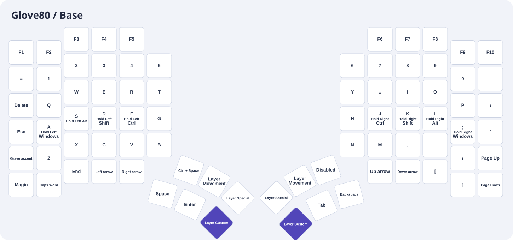
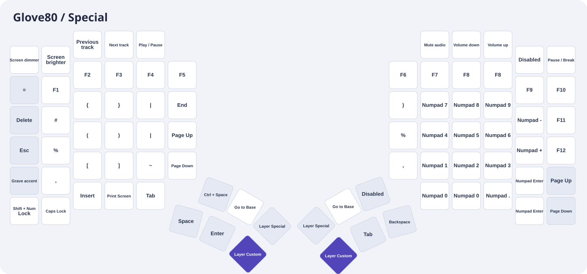
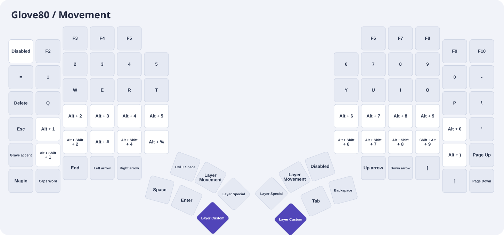
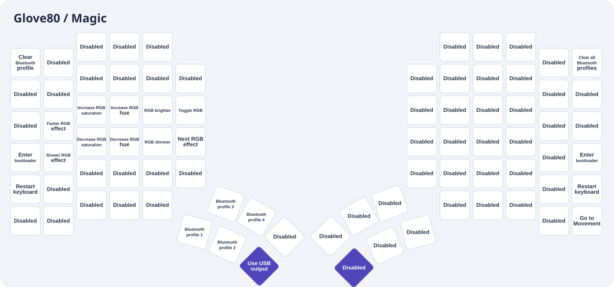
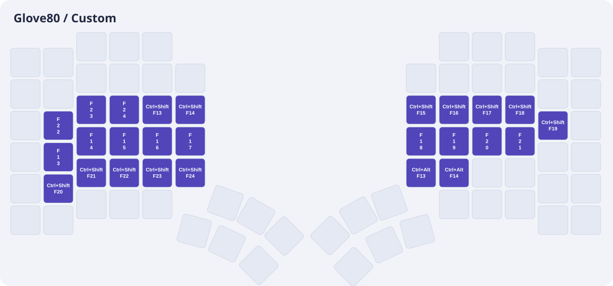

# Glove80 layers

These diagrams show the five layers from the Glove80 firmware snapshot used by the layout editor. Shaded keys inherit a lower layer. The two purple thumb keys reach Custom, where the highlighted keys show the Windows shortcut chords.

## Base

## Special

## Movement

## Magic

## Custom

Only Custom-layer overrides are labeled. Blank keys inherit their behavior.

