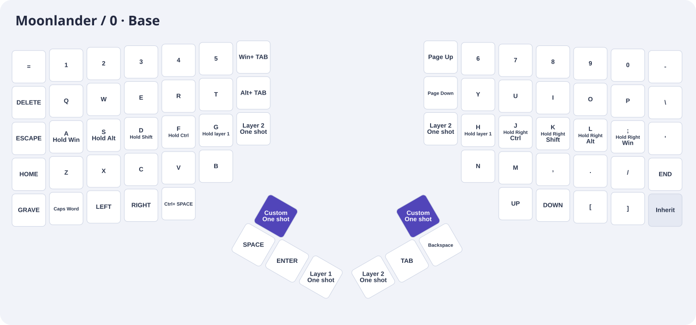
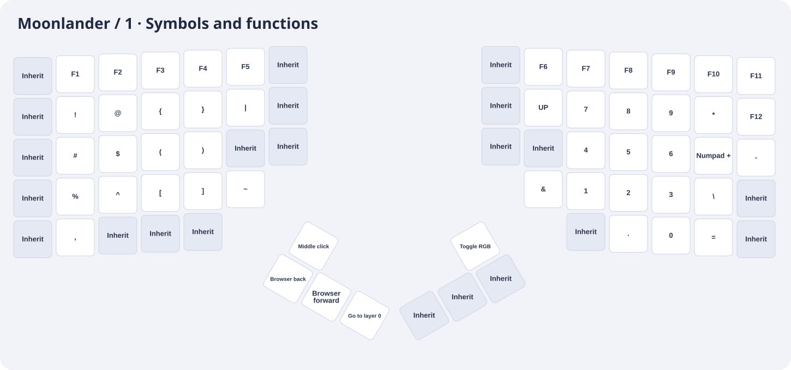
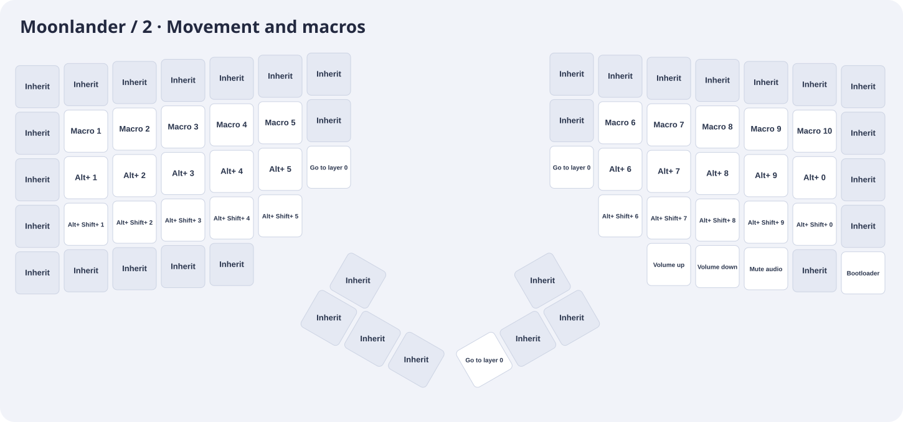
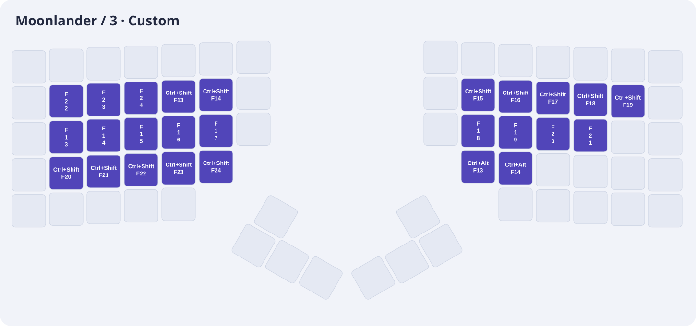

# Moonlander layers

These diagrams show the four layers in the [Moonlander QMK source](../../firmware/moonlander/keymap.c). The first three layers come from the Oryx baseline. Layer 3 uses the Glove80 Custom shortcuts. Shaded keys inherit a lower layer, and the physical diagrams are schematic.

## 0. Base

## 1. Symbols and functions

## 2. Movement and macros

## 3. Custom

Only Custom-layer overrides are labeled. Blank keys inherit their behavior.

